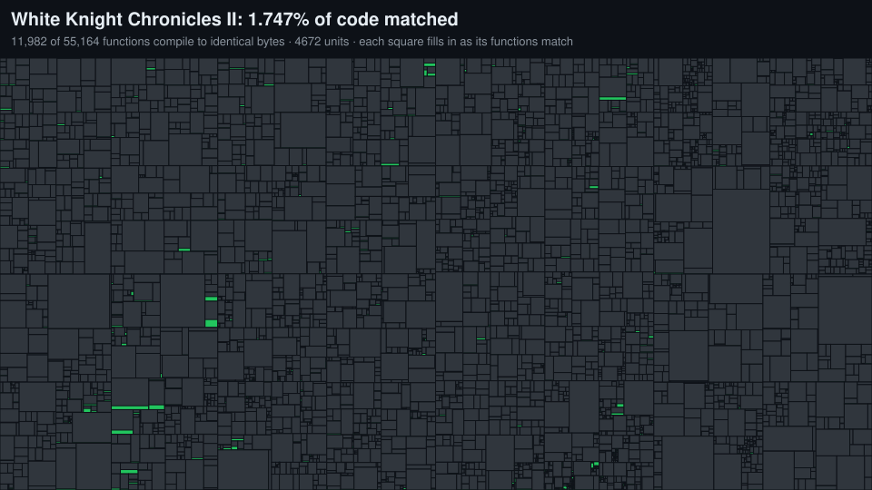

# White Knight Chronicles II: Byte Match

A **matching decompilation** of White Knight Chronicles II (PS3, USA,
BLUS30784 v01.00): readable C and C++ source that, compiled with the same
compiler Sony shipped to developers, produces **byte-for-byte the same machine
code** as the game's own executable.

Each square is a unit of the game's code, sized by how much code it
holds. It fills in from the bottom: **green** is code that compiles to identical
bytes, **blue** is partly matched, **grey** is not started yet. The map is
redrawn from `progress/report.json` with every progress update.

## How this differs from the main project

This is an **alternative** to
[White-Knight-Chronicles-2-Recomp](https://github.com/WK2D/White-Knight-Chronicles-2-Recomp),
not a replacement for it.

| | Recomp (main repo) | Byte Match (this repo) |
| --- | --- | --- |
| Approach | Static recompilation: the PS3 machine code is translated to C automatically and run on PC with a PS3 runtime layer | Decompilation by hand: each function is rewritten as readable C/C++ |
| Plays today | Yes, with known issues | No; this is source being recovered |
| Proof of correctness | The game runs; specific systems are checked against the original | Every matched function compiles to exactly the original bytes |
| End goal | A playable PC version | Complete, readable source for the whole game, which a fully native PC version can be built from |

The two meet in the middle. Every function matched here is real C++ that the
recomp can call in place of its translated version, so the PC build becomes
more native with every green square.

## Status

- **Compiler:** solved. The game was built with Sony's PPU GCC
  `4.1.1 (SDK310, $Rev: 3320 $)`. Sony published that toolchain's source under
  the GPL; [`tools/build_compiler.sh`](tools/build_compiler.sh) rebuilds it from
  the [SDK 3.1.0 source package](https://github.com/sagemono/ps3gcc)
  (`$Rev: 3364 $`, the same SDK release). Its output already matches real game
  functions byte for byte.
- **Compiler flags:** `-O2 -fno-ivopts`. A counted loop in `CPostEffectManager`
  matches only with induction-variable optimization off.
- **Code:** 55,164 functions in 16.5 MB of PowerPC code. **11,956 match**
  (1.74% of the code): three by hand, the rest small functions written by
  [`tools/gen_simple.py`](tools/gen_simple.py) from their instruction shape
  (empty bodies, constant returns, field getters and setters, global loads,
  struct clears, tail calls with constant arguments, empty derived-class
  destructors), and functions lifted to C from their machine code by
  [`tools/lift.py`](tools/lift.py). Every one is verified byte for byte like
  any other.
- **Units:** about 4,600, inferred from the stripped executable by
  [`tools/make_units.py`](tools/make_units.py). C++ RTTI names 1,032 classes,
  and their vtables, constructors and destructors label the code around them.
  Where no class is known, a new unit starts where the functions' TOC entries
  (each source file's table of global addresses) move past the previous
  file's. These are estimates: units are renamed to their real source files as
  those are identified. The executable keeps assert strings with the original
  paths, such as `src/system/movie/Movie.cpp` from the game and
  `mx_renderengine.cpp` from Level-5's engine library.

## Getting started

You need Docker, Python 3 and your own copy of the game.

1. Copy your decrypted executable to `orig/EBOOT.elf` (see
   [orig/README.md](orig/README.md); the tools check its SHA-1).
2. Build the compiler once: `sh tools/build_compiler.sh` (about ten minutes).
3. Check everything: `python tools/check.py -v`. This compiles `src/`, compares
   each mapped function with the original, and writes `progress/report.json`.
4. Redraw the map: `python tools/progress_map.py`.

To re-infer units: `python tools/classes.py`, then `python tools/make_units.py`.

## Matching a function

1. Pick a function from [config/functions.txt](config/functions.txt) and read
   its original code (`ppu-lv2-objdump -D --start-address=… orig/EBOOT.elf`).
2. Write it in the `src/` file of its unit.
3. Add its address and compiled symbol (`.name`) to
   [config/symbols.txt](config/symbols.txt).
4. Run `python tools/check.py -v` until it says `MATCH`.

The checker masks only the fields a linker fills in: call and branch targets
to other functions and 16-bit address or TOC offsets. Everything else, every
register and every instruction, has to be identical.

## Layout

| Path | What it holds |
| --- | --- |
| `src/` | Decompiled source, one file per unit |
| `include/` | Shared headers |
| `config/functions.txt` | Every function's address and size in the original `.text` |
| `config/units.txt` | Unit boundaries (inferred; edit freely) |
| `config/symbols.txt` | Which compiled function stands for which original address |
| `progress/` | The objdiff-format progress report and the map drawn from it |
| `tools/` | Compiler build, checker, class and unit inference, bulk generator, map scripts |
| `src/gen/` | Generated small functions, one file per unit |
| `src/lift/` | Straight-line functions lifted to C, one file per unit |
| [`HANDOFF.md`](HANDOFF.md) | State, workflow and pitfalls for whoever picks this up next |
| `orig/` | Your own game files (never committed) |

## Legal

This repository contains no game code, data or assets. You need your own copy
of the game. GCC and binutils are GPL software; the compiler is built from
Sony's published GPL source package.
